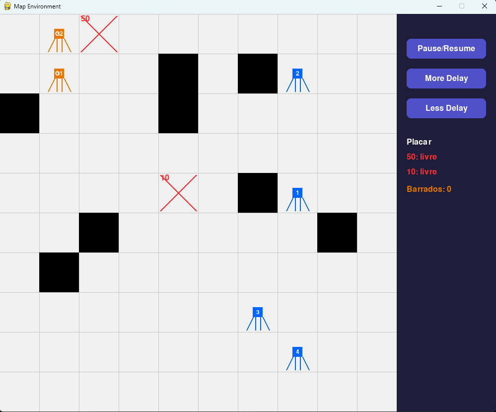
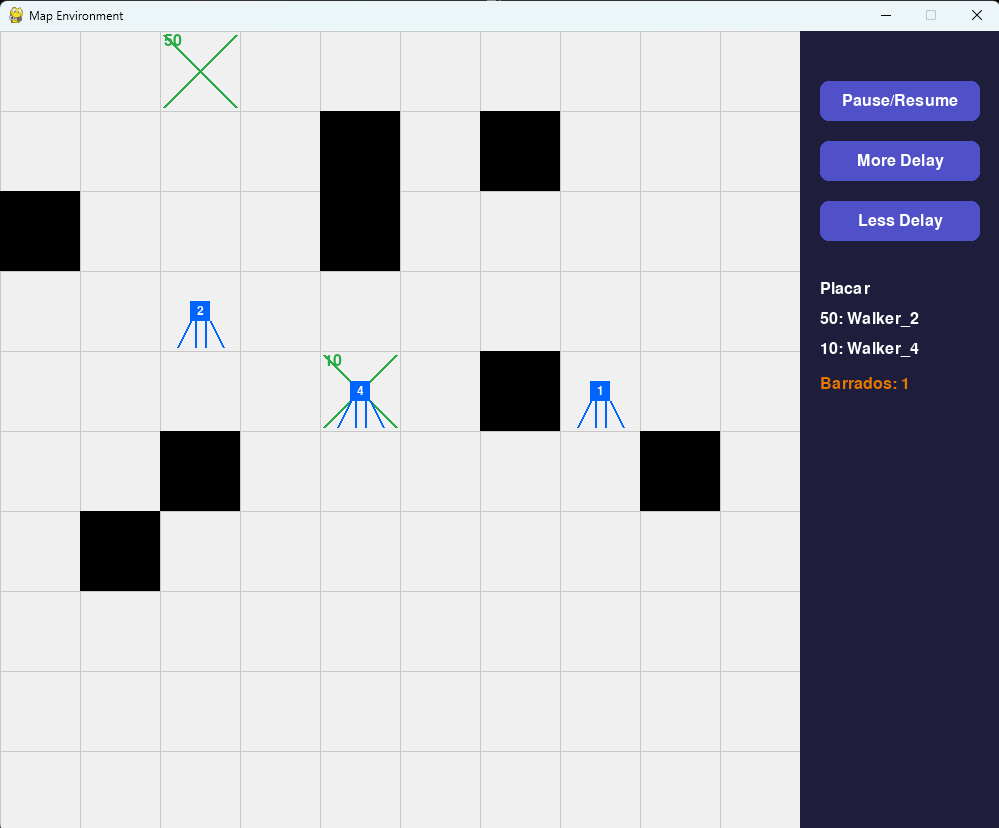
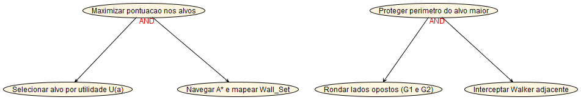
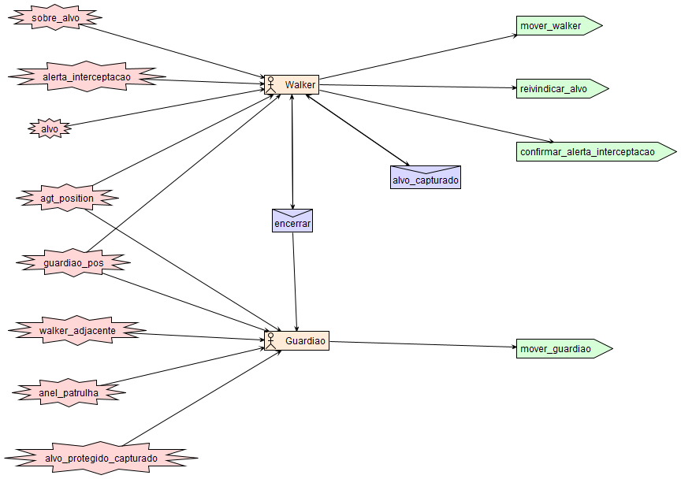
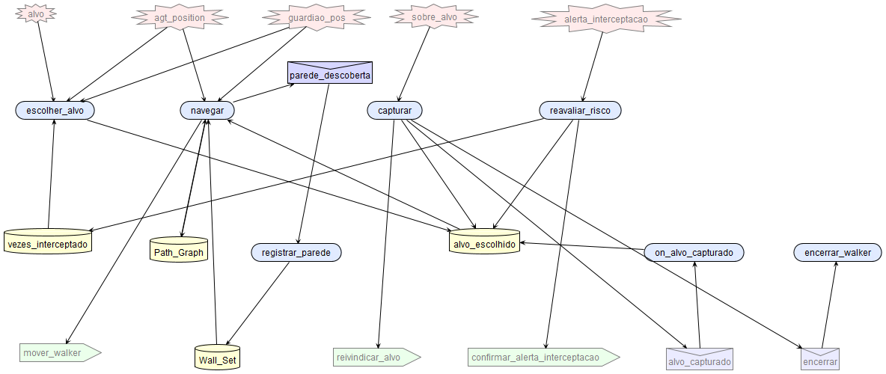
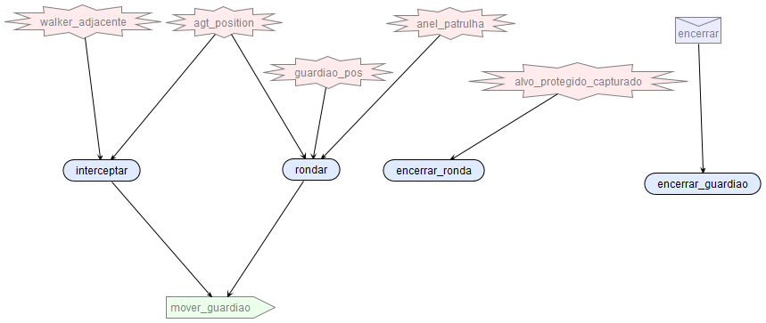
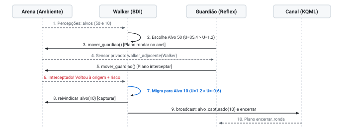
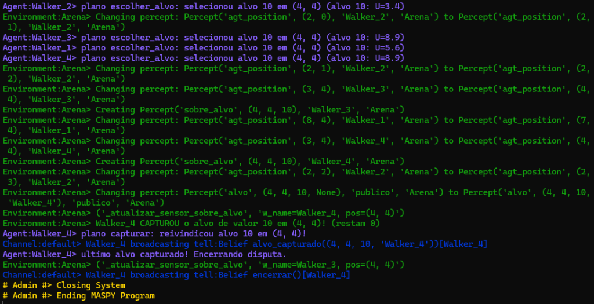

**Projeto Inicial (PI) — Sistemas Multiagentes - UTFPR - 2026/2**

- HUDSON DIEGO FERREIRA DE OLIVEIRA
- GABRIEL MARTINS SILVA
- LOUIS BROMMELSTROET

# Walkers Competitivos com Alvos de Valores Distintos e Dois Agentes Guardiões em Grid 2D (MASPY)

## 1. Descrição do Problema e Extensão Proposta

Partindo do exemplo base *Navigation on 2D Grid* do framework **MASPY** (`maspy-ml`), este projeto modela e implementa um ambiente competitivo em um grid bidimensional com paredes ocultas e **dois alvos de valores distintos** (padrão: `10` e `50`). Múltiplos agentes **Walker** são posicionados aleatoriamente sem conhecimento prévio das paredes e competem para maximizar sua pontuação capturando os alvos disponíveis.

Para enriquecer a dinâmica multiagente mantendo uma arquitetura minimalista e 100% aderente às primitivas nativas do MASPY (`Environment`, `Percept` com filtro de grupos e `Channel` KQML), introduziu-se um segundo tipo de agente situado no grid: o **Guardião**, instanciado em dupla (`Guardiao_1` e `Guardiao_2`). Enquanto os Walkers atuam orientados à utilidade e planejamento de rota (A*), os **2 Guardiões** patrulham em lados diametralmente opostos o perímetro do alvo de maior valor (`50`) e interceptam Walkers próximos, devolvendo-os à origem e criando um dilema real de *recompensa versus risco e distância*.

|  |  |
|---|---|
| *Interface em andamento: Guardiões (G1 e G2 em laranja) em ronda perimetral no alvo 50, Walkers (em azul) explorando células livres e placar lateral.* | *Encerramento da partida: Alvo 50 capturado por Walker_2 e alvo 10 por Walker_4 após interceptação registrada no placar (Barrados: 1).* |

A interface gráfica interativa desenvolvida em **Pygame** (`MapVisualizer`) reflete visualmente essa dinâmica em tempo real: o grid bidimensional exibe os agentes em suas respectivas posições, as paredes ocultas reveladas conforme as colisões (blocos pretos) e os alvos identificados em vermelho (livres) ou verde (capturados). Pela barra lateral direita, o usuário pode pausar, retomar e ajustar a velocidade dos ciclos (`delay`), além de acompanhar em tempo real o placar de capturas e a contagem de interceptações efetuadas pelos Guardiões.

---

## 2. Especificação do Ambiente de Tarefa (PEAS)

### 2.1 Tabelas PEAS por Papel de Agente

| Component 1 | Walker Agent (1..N) — Description |
|---|---|
| **Performance Measure** | Maximizar a soma dos valores dos alvos capturados (ex.: `50` e `10`), minimizando o número de passos executados e o número de interceptações sofridas pelos 2 Guardiões. |
| **Environment** | Grid 2D discreto (`Arena`) com paredes fixas ocultas, 2 alvos de valores distintos e outros agentes ativos (Walkers rivais e 2 Guardiões), com características: **partially observable; deterministic** (transições de ação, com inicialização estocástica); **sequential; dynamic; discrete; and multi-agent** (competitivo). |
| **Actuators** | Atuadores físicos na `Arena`: `mover_walker(direction)` (`up`, `down`, `left`, `right`, `stay`), `reivindicar_alvo(x, y)` e `confirmar_alerta_interceptacao()`; envio de mensagens KQML via `broadcast` no canal (`alvo_capturado` e `encerrar`). |
| **Sensors** | Percepções filtradas por grupo (`filter_perceptions` com foco em `[self.my_name, "publico"]`): coordenada `agt_position(x, y)`, alvos `alvo(x, y, valor, dono)`, posições `guardiao_pos(g_id, gx, gy)`, sensores privados `sobre_alvo(tx, ty, valor)` e `alerta_interceptacao(n)`, retorno físico de colisão em parede e mensagens no `Channel`. |

 

| Component 2 | Guardião Agent (2 instâncias: G1 e G2) — Description |
|---|---|
| **Performance Measure** | Maximizar o número de interceptações de Walkers invasores no perímetro do alvo de maior valor e retardar sua captura por meio de ronda coordenada em lados opostos do anel. |
| **Environment** | Mesmo grid 2D (`Arena`), atuando exclusivamente no anel de patrulha (distância de Manhattan 1 a 2) ao redor do alvo de maior valor: **partially observable; deterministic; sequential; dynamic; discrete; and multi-agent**. |
| **Actuators** | Atuador puramente físico `mover_guardiao(direction)` (desloca o Guardião 1 célula na direção decidida pelo seu plano BDI, sem lógica decisória no `Environment`). |
| **Sensors** | Sensores BDI na `Arena`: detecção reflexa privada `walker_adjacente(w_id, wx, wy)` (raio $\le 2$), própria posição `agt_position(gx, gy)`, posições públicas `guardiao_pos`, células livres `anel_patrulha`, sinal `alvo_protegido_capturado` e mensagem `encerrar`. |

### 2.2 Classificação Detalhada das Propriedades do Ambiente

| Dimensão | Classificação | Justificativa no Domínio |
|---|---|---|
| **Observabilidade** | *Partially Observable* | As paredes pertencem ao grupo `"oculto"` no `Environment`; os Walkers não enxergam o labirinto nem a posição dos Walkers rivais, descobrindo obstáculos apenas ao colidir. |
| **Determinismo** | *Deterministic* (regras) / *Stochastic* (sorteio inicial) | Dado o estado exato do grid, o efeito de cada movimento e da validação atômica de captura (protegida por `RLock`) é determinístico; apenas a geração inicial do mapa é estocástica, mas sob a perspectiva individual de cada agente há incerteza causada pelas ações simultâneas dos demais. |
| **Episódico vs. Sequencial** | *Sequential* | Cada ação altera a posição futura do agente, o mapa parcial na *Belief Base* (`Path_Graph` / `Wall_Set`) e o risco acumulado em `vezes_interceptado`, impactando todas as decisões subsequentes até o fim da partida. |
| **Estático vs. Dinâmico** | *Dynamic* | Enquanto um Walker delibera em sua thread, os 2 Guardiões se deslocam pelo perímetro e Walkers concorrentes podem capturar o alvo visado a qualquer instante. |
| **Discreto vs. Contínuo** | *Discrete* | Espaço de coordenadas inteiras *W × H*, conjunto finito de 5 ações de movimento e ciclos discretos de raciocínio BDI. |
| **Número de Agentes** | *Multi-agent* (Competitivo) | *N* Walkers disputam recursos exclusivos (cada alvo só pode ter um único `dono`) enquanto 2 Guardiões (`Guardiao_1` e `Guardiao_2`) atuam de forma antagônica protegendo o alvo principal. |

---

## 3. Definição dos Tipos de Agentes (Russell & Norvig)

A tabela abaixo posiciona a arquitetura desenvolvida frente às cinco categorias clássicas de agentes inteligentes:

| Categoria | Presença no Projeto | Análise e Mapeamento na Implementação |
|---|---|---|
| **Simple Reflex Agent** | Implementado: 2 Guardiões | `Guardiao_1` e `Guardiao_2` não possuem crenças internas de estado nem algoritmos de busca; cada regra condição-ação é um plano `@pl` distinto para `Goal("patrulhar")` selecionado pelo motor BDI do MASPY: `interceptar` (se há `walker_adjacente`), `rondar` (avanço horário em `anel_patrulha`) ou `encerrar_ronda` (se `alvo_protegido_capturado`). |
| **Reflex Agent with State** | Subsumido no Walker | Não há um agente exclusivamente reativo com estado isolado, mas o `Walker` mantém modelo explícito do mundo na *Belief Base* do MASPY (`Belief("Path_Graph")`, `Belief("Wall_Set")` atualizada pelo evento `registrar_parede` e `Belief("vezes_interceptado")`) frente à observabilidade parcial. |
| **Goal-based Agent** | Implementado: Walker | O `Walker` decompõe `Goal("agir")` em planos concorrentes selecionados por contexto (`capturar`, `reavaliar_risco`, `escolher_alvo` e `navegar`), empregando busca heurística **A* com flanqueio** até `Belief("alvo_escolhido")`. |
| **Utility-based Agent** | Implementado: Walker | No plano `escolher_alvo` (ativado sob contexto `~Belief("alvo_escolhido")`), o `Walker` avalia uma função explícita de utilidade calibrada para arbitrar racionalmente entre o alvo protegido (`50`) e o desprotegido (`10`). |
| **Learning Agent** | Não utilizado | Optou-se por planejamento online A* com utilidade adaptativa em vez de Q-learning pré-treinado, pois os alvos são consumidos dinamicamente durante uma única corrida competitiva sem repetição de episódios sobre o mesmo mapa. |

> **Função de Utilidade Calibrada e Custo de Flanqueio do Walker (frente aos 2 Guardiões):**
> 
> $$U(a) = \text{valor}(a) - 1{,}1 \cdot \text{manhattan}(\text{pos}, a) - \text{risco}(a, \text{pos}, \text{pos}_{G1}, \text{pos}_{G2})$$
> 
> Onde `risco = 0` para o alvo desprotegido (`10`) e, para o alvo protegido pelos 2 Guardiões (`50`), vale `8,0 + 36,0 · vezes_interceptado` (acrescido de `+4,0` se $\min_{i \in \{1,2\}} d(\text{pos}, G_i) \le 2$). Com essa calibração, todos os Walkers iniciam disputando o alvo `50` ($U(50) \approx 35 \gg U(10) \approx 1$), mas basta **uma interceptação** para inverter a utilidade esperada ($U(50) \approx -0{,}6 < U(10) \approx 1{,}2$), fazendo o plano `escolher_alvo` migrar autonomamente para o alvo `10` enquanto o `50` ainda está em disputa. No plano `navegar`, células ocupadas ou adjacentes a `G1/G2` recebem penalidade A* (`+6,0` e `+2,0`), induzindo flanqueio pelas brechas.

---

## 4. Modelagem Prometheus (PDT 3.2b)

A especificação arquitetural e detalhada foi construída nativamente na ferramenta oficial **Prometheus Design Tool (PDT 3.2b)** (arquivo de projeto `pdt/Walker_Guardiao_MASPY.pd`, validado sem alertas no *Crosscheck* de Projeto Arquitetural e Detalhado). As Figuras 1, 2 e 3 foram exportadas diretamente pelo PDT 3.2b.

*Figura 1 — Goal Overview Diagram (topo) e System Overview Diagram (base) gerados nativamente no PDT 3.2b (Walker_Guardiao_MASPY.pd).*

|  |  |
|---|---|
| *Figura 2a — Agent Overview Diagram do Walker no PDT 3.2b (seleção BDI entre escolher_alvo, navegar, capturar, reavaliar_risco, evento registrar_parede e crenças Path_Graph, Wall_Set, vezes_interceptado, alvo_escolhido).* | *Figura 2b — Agent Overview Diagram do Guardiao no PDT 3.2b (Simple Reflex sem memória interna: planos interceptar, rondar e encerrar_ronda sobre mover_guardiao).* |

### 4.1 Especificação Estrutural dos Agentes (Agent Descriptors)

| Agente | Objetivos & Crenças | Planos BDI Selecionados por Contexto (`@pl`) | Interação (Ambiente & Canal) |
|---|---|---|---|
| **Walker** (*N* instâncias) | **Goal:** `agir` **Beliefs:** `Path_Graph`, `Wall_Set`, `vezes_interceptado`, `alvo_escolhido` | `capturar` (ctx: `sobre_alvo`); `reavaliar_risco` (ctx: `alerta_interceptacao`); `escolher_alvo` (ctx: `~alvo_escolhido`); `navegar` (ctx: `alvo_escolhido`, A* flanqueio); `registrar_parede`, `on_alvo_capturado`, `encerrar`. | **Foco:** `[my_name, "publico"]` **Atuadores:** `mover_walker`, `reivindicar_alvo`, `confirmar_alerta_interceptacao` **KQML:** `broadcast tell` (`alvo_capturado`, `encerrar`) |
| **Guardião** (2 instâncias: `G1` e `G2`) | **Goal:** `patrulhar` **Beliefs internas:** nenhuma (*Simple Reflex* puro sem estado) | `encerrar_ronda` (ctx: `alvo_protegido_capturado`); `interceptar` (ctx: `walker_adjacente & agt_position`); `rondar` (ctx: `agt_position & anel_patrulha`); `encerrar` (evento KQML: `stop_cycle()`). | **Foco:** `[my_name, "publico"]` **Atuador físico:** `mover_guardiao(dir)` **KQML:** escuta `Belief("encerrar")` |

### 4.2 Diagrama de Interação e Seleção de Planos BDI no MASPY

*Figura 3 — Arquitetura BDI pura no MASPY: sensores e atuadores físicos na Arena e seleção de planos por contexto em Walker e Guardiao.*

### 4.3 Diagrama de Sequência das Interações BDI

*Figura 4 — Diagrama de sequência da dinâmica multiagente: ronda, interceptação com migração de utilidade e captura atômica via canal KQML.*

---

## 5. Organização do Código MASPY, Projeto PDT e Evidência Experimental

| Arquivo | Responsabilidade na Implementação |
|---|---|
| `arena_env.py` | Classe `Arena(Environment)` puramente física: geração do grid conectado, sensores filtrados por grupo (`sobre_alvo`, `walker_adjacente`, `alerta_interceptacao`, `anel_patrulha`) e atuadores atômicos sob `RLock` (`mover_walker`, `mover_guardiao`, `reivindicar_alvo`). |
| `agentes.py` | Deliberação BDI pura: `Guardiao(Agent)` sem estado com 3 planos concorrentes (`interceptar`, `rondar`, `encerrar_ronda`) e `Walker(Agent)` com 4 planos concorrentes em `Goal("agir")` + planos reativos (`registrar_parede` em `Wall_Set`, `on_alvo_capturado`, `encerrar`) e `astar_flanqueio` sobre `Path_Graph`. |
| `Pygame_Screens.py` | Interface visual baseada nas telas de Walkers do MASPY (`MenuScreen` e `MapVisualizer`), com controles de pausa, velocidade (delay inicial de `0.8s`) e destaque dos 2 Guardiões (`G1` e `G2`). |
| `main.py` | Instanciação de `NUM_GUARDIOES = 2` e *N* Walkers (`DELAY_INICIAL = 0.8`), com execução gráfica (`python main.py`) ou em terminal (`python main.py --sem-gui`). |
| `pdt/Walker_Guardiao_MASPY.pd` | Projeto nativo do **PDT 3.2b** validado sem alertas no *Crosscheck* contendo *Goal Overview*, *System Overview*, *Agent Overviews* (`Walker` e `Guardiao`) e descritores completos (`pdt/abrir_pdt.bat`). |

**Trecho real de execução validada (`python main.py --sem-gui`):** evidencia no log do MASPY a deliberação dos planos (`escolher_alvo`, `capturar`), o acionamento de sensores (`sobre_alvo`), atualização de percepções atômicas e a comunicação KQML via canal (`alvo_capturado`, `encerrar`):

*Figura — Registro real de execução no terminal evidenciando a deliberação BDI dos Walkers, captura atômica de alvo e encerramento coordenado via KQML.*

**Referências:** 
- Russell, S. & Norvig, P. *Artificial Intelligence: A Modern Approach* (PEAS & Agent Types); 
- Padgham, L. & Winikoff, M. *Prometheus: A Methodology for Developing Intelligent Agents* (AAMAS'02);
- LaCA-IS/UTFPR — *MASPY Framework Wiki: Navigation on 2D Grid*.
